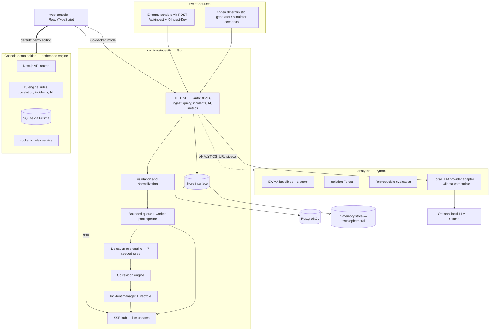
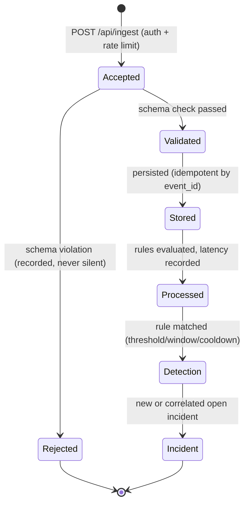
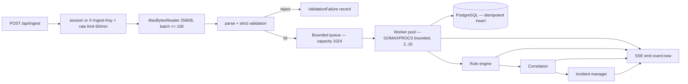
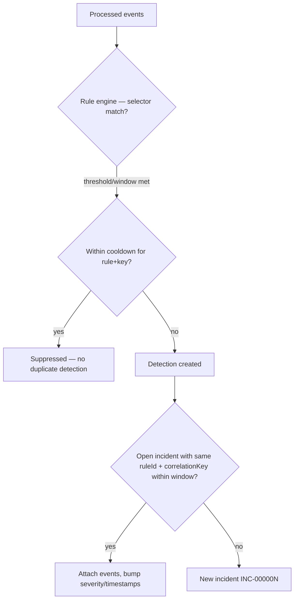
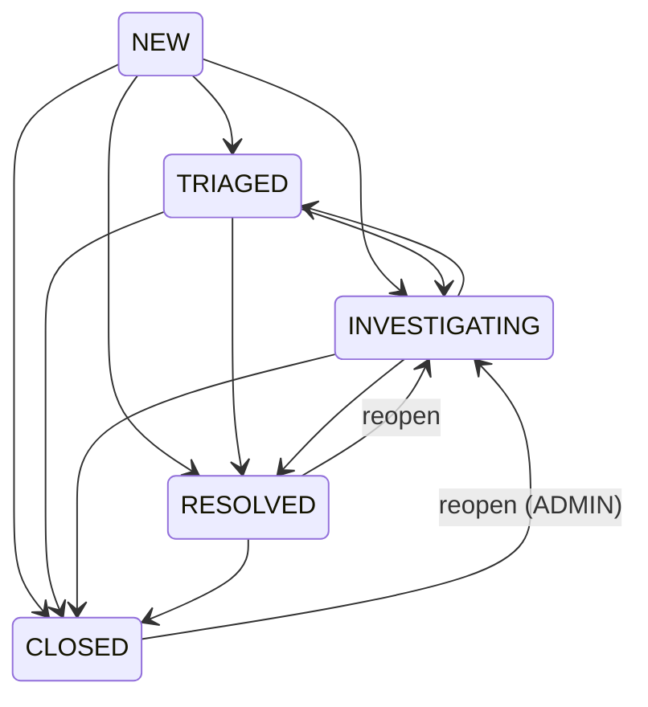
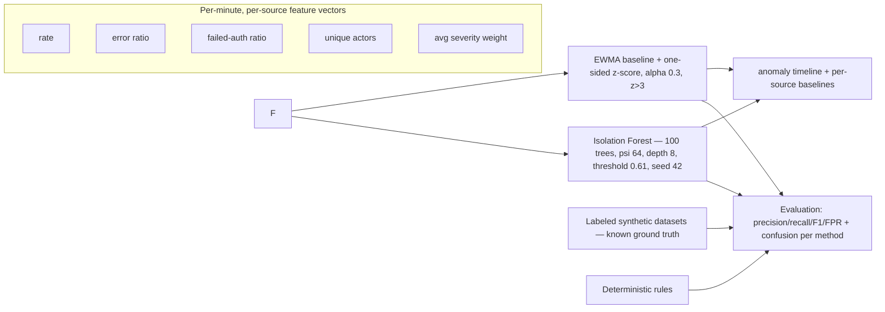
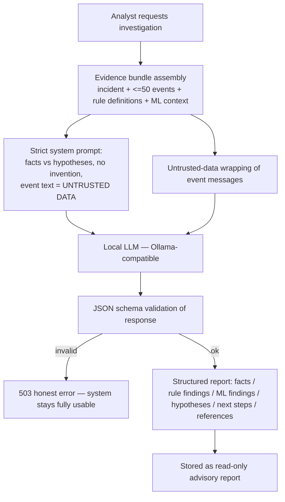
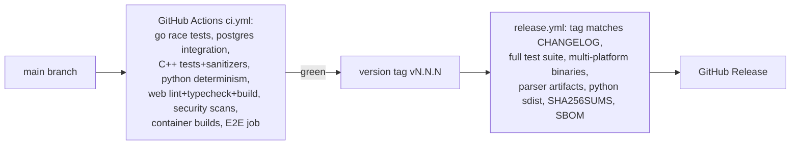

# StreamGuard — Architecture

Copyright © 2026 Parsa Fathi — Apache-2.0

This document describes the architecture **as implemented**. Where a component
is optional or edition-specific, that is stated explicitly.

## 1. System overview

StreamGuard is a real-time event ingestion, processing, monitoring and security
analytics platform with three testable backends sharing one contract:

- **Go reference service** (`services/ingestor`) — production-oriented HTTP API,
  ingestion, validation, bounded processing pipeline, detection rules,
  correlation, incident management, SSE live updates, metrics. PostgreSQL for
  persistence (in-memory store for tests and ephemeral runs).
- **Python analytics package** (`analytics`) — statistical baselines, Isolation
  Forest anomaly detection, reproducible evaluation on labeled synthetic
  datasets, and an optional local-LLM provider adapter. Runs as a sidecar
  service (HTTP) or as a library/CLI.
- **Web console** (`web`) — the React/TypeScript single-page application
  (Next.js). It ships in two modes: the **console demo edition** (embedded
  engine on SQLite — the default, fully self-contained) and **Go-backed mode**
  (the same UI pointing at the Go service through `NEXT_PUBLIC_API_BASE` with
  SSE live transport).

A C++20 parser library (`native/parser`) provides an optional high-performance
parsing/validation component with a stable C ABI, used through an optional
build tag in the Go service (pure-Go parser is the default).

## 2. Editions (explicit)

| | Console demo edition (`web`, default) | Go reference edition |
|---|---|---|
| Purpose | evaluation, training, demo of the full product behavior | production-oriented deployment |
| Backend | Next.js API routes (TypeScript) embedded in the console | `services/ingestor` (Go) + PostgreSQL |
| Store | SQLite via Prisma | PostgreSQL (or in-memory, non-durable) |
| Live updates | socket.io relay service (`mini-services/stream`) | SSE (`GET /api/stream`) |
| AI provider | sandbox-configured provider via `z-ai-web-dev-sdk` (server-side only) | any Ollama-compatible local endpoint |
| ML | TS port of the same methods (EWMA + Isolation Forest, same parameters) | Python package via sidecar, or its own Go implementation of the same methods |

Both editions implement the same API/data contract, so the console UI works
against either. The demo edition labels all simulator data `origin=synthetic`.

## 3. Event lifecycle and processing semantics

Documented guarantees:

- **Accepted** means the request passed authentication, rate limiting, size
  limits and JSON shape — it does **not** mean downstream processing finished.
- **Idempotency:** duplicate `event_id` values are acknowledged (`duplicates`
  count) without re-storing or re-running detection.
- **At-least-once within a process** for the pipeline stages; no exactly-once
  claim is made across process restarts in the in-memory store. With
  PostgreSQL, event storage is transactional and idempotent by primary key.
- **Late/out-of-order events:** processed by ingestion time windows; events
  attaching to an incident past the correlation window are flagged `late`.
- **Validation failures** are recorded (reason + truncated sample ≤ 256 bytes)
  and feed rule SG-RULE-007 (ingestion validation failures).

## 4. Ingestion pipeline (Go)

- Backpressure: a full bounded queue rejects the ingest request with
  `429` + `Retry-After` rather than growing without bound.
- Graceful shutdown: stop accepting → drain queue with a 10s budget → close
  dependencies.
- All SQL is parameterized; no string-built queries anywhere.

## 5. Detection rules, correlation, incidents

Seven deterministic rules ship seeded (SG-RULE-001..007: repeated
authentication failures, abnormal request rate, suspicious auth sequence, error
rate spike, repeated authorization failures, unexpected configuration change,
ingestion validation failures). Each rule: stable id, selector, condition
(count/ratio/sequence/exists), threshold + window, severity, cooldown,
suppression, version, and audit history of changes.

Correlation keys: `actor` for authentication rules, `source_id` for rate/error
rules, per-rule derivation is documented in the rule table (see README).
Incident lifecycle with validated transitions only:

Every transition, assignment and resolution is recorded with actor + timestamp
(audit trail). Resolution requires a summary (≥ 10 chars). AI-generated
analysis never changes incident state.

## 6. Analytics and ML boundary

- The same method parameters are implemented in the Python package and the
  console demo edition (TS port) — results are deterministic given the seed.
- Evaluation runs on **synthetic labeled scenarios**; numbers are reported as
  evaluation results, not production accuracy claims. Method-specific blind
  spots are documented honestly (e.g. z-score absorbs sustained shifts after
  onset; rules cannot see latency-only anomalies; isolation forest misses
  anomalies when the normal cloud is wide).
- Model version is recorded with every evaluation run and every ML finding
  surfaced to the UI.

## 7. AI investigation assistant — evidence grounding and safety

Safety boundaries (enforced, not aspirational): the assistant is advisory
only; it executes nothing, accesses no secrets, cannot alter rules or
incidents, treats all event text as data (prompt-injection resistant by
construction — injection attempts remain inside the untrusted block), and
provider status/errors are reported honestly. No automatic cloud fallback:
if the configured local provider is unavailable the feature returns an error
and everything else keeps working.

## 8. Real-time updates

- Go edition: SSE (`GET /api/stream`) — channels `event:new` (batched),
  `detection:new`, `incident:new`, `incident:update`, `stats`, `simulator`;
  keepalive every 15s; per-client buffered channel with drop-slowest policy on
  overflow; `Last-Event-ID` replay of recent messages.
- Console demo edition: socket.io relay (`/?XTransformPort=3003` through the
  sandbox gateway); the Next.js backend POSTs to the relay's internal `/emit`
  endpoint (server-to-server).
- The UI distinguishes live / stale (>15s since last message) / reconnecting /
  disconnected states and invalidates the affected queries on each message.

## 9. Persistence, retention, audit

- PostgreSQL schema (migrations applied at startup under an advisory lock):
  users, sessions, ingest keys, events (idempotent PK), validation failures,
  rules + rule audit, detections, incidents + events + notes + status history,
  audit log, ML runs, AI reports, settings.
- Retention: configurable TTL (default 72h). Events attached to non-CLOSED
  incidents are never deleted. Every retention run is audited and counted.
- Audit: append-only entries for login/logout, rule changes, incident
  transitions/notes, AI investigations, simulator runs, settings changes,
  retention runs. ADMIN-only query endpoint with validated filters.

## 10. Security architecture

- Server-side authentication (bcrypt passwords, opaque sessions with HMAC
  cookies) and RBAC (ADMIN / ANALYST / VIEWER) enforced on every endpoint —
  the UI is never the gate.
- Ingestion: session or ingest-key auth, per-key/user sliding-window rate
  limits (60/min default), 256 KB body / 4 KB event / 100-event batch caps.
- Input validation everywhere (strict schema, enum checks, bounded sizes);
  validation failures recorded, never silently dropped.
- Parameterized SQL only. Secrets redacted from logs (authorization headers,
  cookies, ingest keys). No secrets in any response.
- Threat model table: see `SECURITY.md`.

## 11. Release pipeline

A failed required test blocks the release. See `CHANGELOG.md` for the staged
version history (v1.x through v10.3.2) and what genuinely changed at each
stage.

## 12. Known limitations (honest)

- The in-memory Go store is non-durable (documented; PostgreSQL is the
  production path).
- PostgreSQL integration tests run in CI only (no local docker in the
  development sandbox used for this work).
- ML evaluation is on synthetic labeled scenarios; no production-traffic
  accuracy is claimed.
- The AI assistant's quality depends on the configured local model; the system
  reports provider status honestly and remains fully functional without it.
- The C++ parser integration in the Go service is optional (build tag); the
  default pure-Go parser is used unless explicitly enabled.
