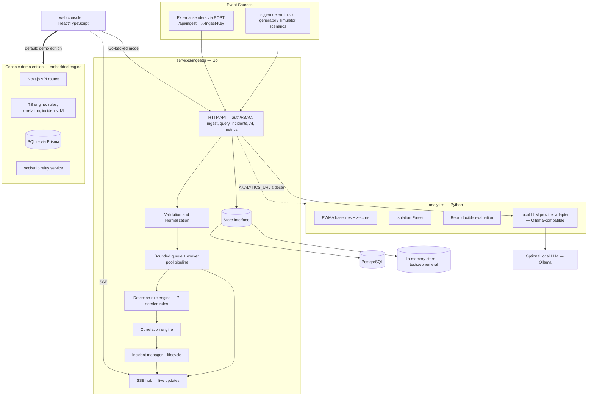
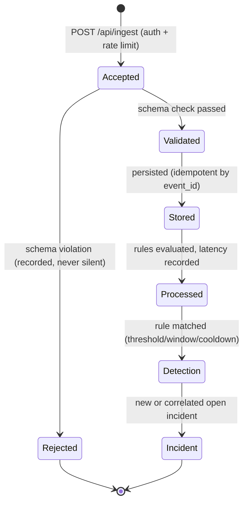
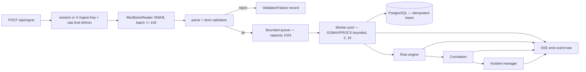
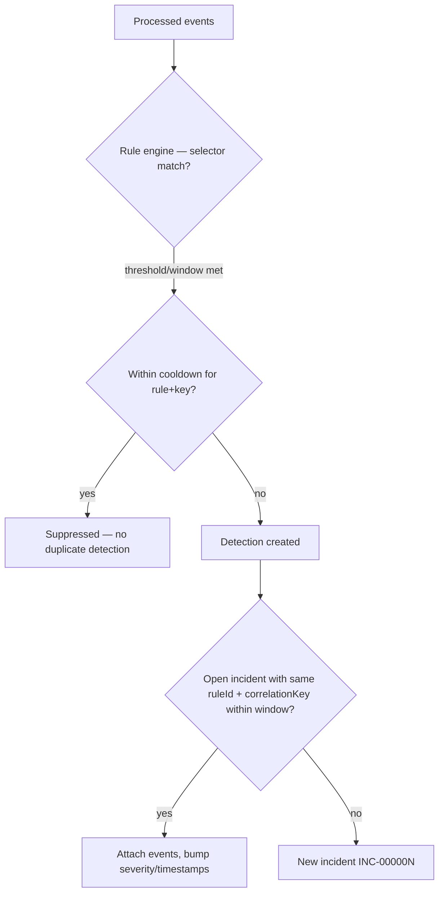
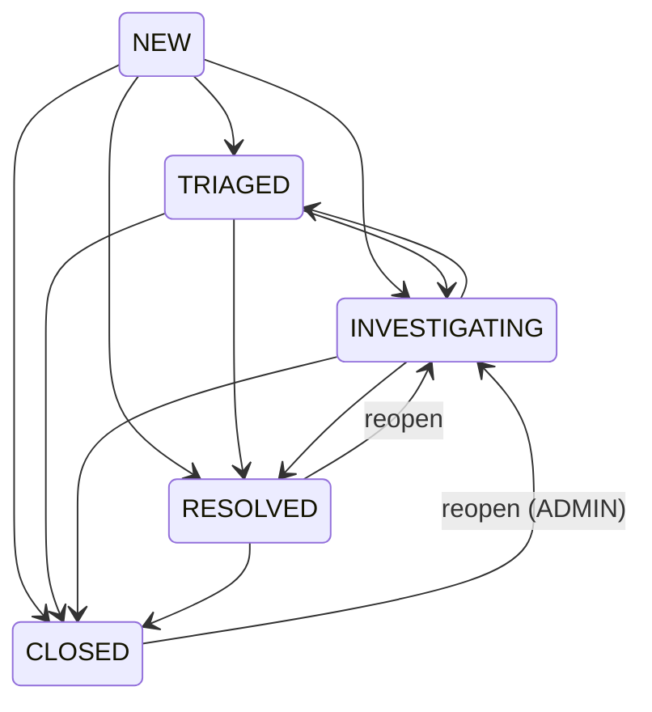
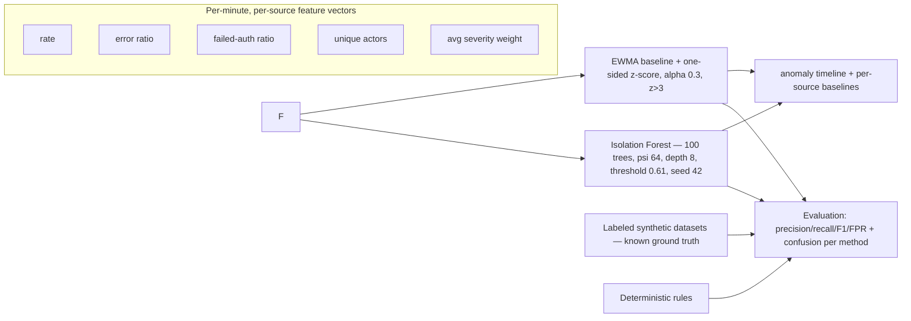
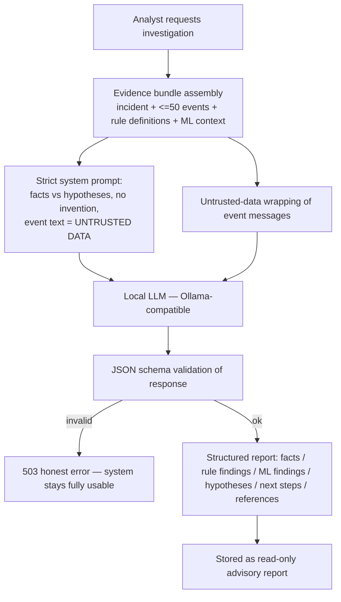
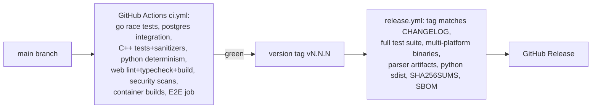

<!-- Copyright © 2026 Parsa Fathi — Apache-2.0 -->

# معماری StreamGuard (نسخهٔ فارسی)

این سند معماری را **همان‌گونه که پیاده شده** توصیف می‌کند. هر جا جزئی اختیاری یا
مخصوص یک نسخه است، صریحاً ذکر می‌شود. کد دیاگرام‌ها عیناً از نسخهٔ انگلیسی کپی شده است
(رندر GitHub فقط با متن انگلیسی دیاگرام‌ها درست کار می‌کند)؛ توضیحات فارسی است.

نسخهٔ انگلیسی: [ARCHITECTURE.md](../../ARCHITECTURE.md) — مطالعهٔ مرتبط:
[README_FA.md](README_FA.md).

## ۱. نمای کل سامانه

StreamGuard یک سکوی دریافت، پردازش، پایش و تحلیل امنیتی رخداد لحظه‌ای است با سه
پس‌زمینهٔ قابل تست که یک قرارداد مشترک دارند:

- **سرویس مرجع Go** (`services/ingestor`) — API عملیات‌گرا: دریافت، اعتبارسنجی، خط لولهٔ
  کران‌دار، قوانین تشخیص، همبستگی، مدیریت حادثه، به‌روزرسانی زندهٔ SSE و متریک‌ها.
  PostgreSQL برای پایایی (ذخیره‌ساز درون‌حافظه‌ای برای تست و اجرای موقت).
- **بستهٔ تحلیل Python** (`analytics`) — خط پایهٔ آماری، Isolation Forest، ارزیابی
  بازتولیدپذیر روی دادهٔ ساختگیِ برچسب‌دار و آداپتور LLM محلی اختیاری. به‌صورت سرویس
  همراه (HTTP) یا کتابخانه/CLI اجرا می‌شود.
- **کنسول وب** (`web`) — اپلیکیشن تک‌صفحه‌ای React/TypeScript (Next.js) در دو حالت:
  **نسخهٔ دموی کنسول** (موتور تعبیه‌شده روی SQLite — پیش‌فرض، کاملاً خودکفا) و
  **حالت Go-backed** (همان UI رو به سرویس Go با `NEXT_PUBLIC_API_BASE` و انتقال SSE).

کتابخانهٔ C++20 (`native/parser`) یک جزء تجزیه/اعتبارسنجی پرسرعت اختیاری با C ABI پایدار
است که از طریق build tag به سرویس Go وصل می‌شود (پارسر پیش‌فرض، Go خالص است).

## ۲. دو نسخهٔ کنسول (صریح)

| | نسخهٔ دموی کنسول (`web`، پیش‌فرض) | نسخهٔ مرجع Go |
|---|---|---|
| هدف | ارزیابی، آموزش و دموی رفتار کامل محصول | استقرار عملیات‌گرا |
| پس‌زمینه | مسیرهای API نکست‌جی‌اس (TypeScript) تعبیه‌شده در کنسول | `services/ingestor` (Go) + PostgreSQL |
| ذخیره‌ساز | SQLite با Prisma | PostgreSQL (یا درون‌حافظه‌ای، غیرپایا) |
| به‌روزرسانی زنده | سرویس رلهٔ socket.io (`mini-services/stream`) | SSE (`GET /api/stream`) |
| سرویس‌دهندهٔ AI | سرویس‌دهندهٔ sandbox از طریق `z-ai-web-dev-sdk` (فقط سمت سرور) | هر endpoint سازگار با Ollama |
| یادگیری ماشین | پورت TS همان روش‌ها (EWMA + Isolation Forest، همان پارامترها) | بستهٔ Python با سرویس همراه، یا پیاده‌سازی Go همان روش‌ها |

هر دو نسخه همان قرارداد داده/API را پیاده می‌کنند، پس UI کنسول با هر دو کار می‌کند.
نسخهٔ دمو همهٔ دادهٔ شبیه‌ساز را `origin=synthetic` برچسب می‌زند.

## ۳. چرخهٔ عمر رخداد و معناشناسی پردازش

تضمین‌های مستندشده:

- **Accepted** یعنی درخواست از احراز هویت، محدودیت نرخ، سقف‌های اندازه و شکل JSON عبور
  کرده — نه اینکه پردازش پایین‌دستی تمام شده باشد.
- **توان‌نمایی:** `event_id` تکراری با شمارندهٔ `duplicates` پذیرفته می‌شود؛ دوباره ذخیره
  یا پردازش نمی‌شود.
- خط لوله داخل یک فرایند «حداقل یک‌بار» است؛ ادعای exactly-once بین ری‌استارت‌ها برای
  ذخیره‌ساز درون‌حافظه‌ای وجود ندارد. با PostgreSQL درج رخداد تراکنشی و با کلید اصلی
  توان‌نما است.
- **رخداد دیررس/بی‌ترتیب:** با پنجره‌های زمانِ «زمان دریافت» پردازش می‌شوند؛ رخدادی که
  بعد از پنجرهٔ همبستگی به حادثه می‌چسبد با پرچم `late` مشخص می‌شود.
- **خطای اعتبارسنجی** ثبت می‌شود (دلیل + نمونهٔ بریده‌شده ≤ ۲۵۶ بایت) و قانون
  SG-RULE-007 را تغذیه می‌کند.

## ۴. خط لولهٔ دریافت (Go)

- فشار معکوس: صف پر، به‌جای رشد بی‌کران، درخواست دریافت را با `429` + `Retry-After` رد
  می‌کند.
- خاموشی منظم: توقف پذیرش → تخلیهٔ صف با بودجهٔ ۱۰ ثانیه → بستن وابستگی‌ها.
- تمام SQL پارامتری است؛ هیچ جایی رشته‌ای به‌هم چسبانده نمی‌شود.

## ۵. قوانین، همبستگی و حادثه‌ها

هفت قانون قطعی seed شده‌اند (SG-RULE-001..007). هر قانون: شناسهٔ پایدار، انتخابگر، شرط
(count/ratio/sequence/exists)، آستانه + پنجره، شدت، فروکش، فرونشانی، نسخه و تاریخچهٔ
ممیزی تغییرات.

کلید همبستگی: `actor` برای قوانین احراز هویت و `source_id` برای قوانین نرخ/خطا؛ مشتق
کلید هر قانون در جدول قوانین مستند شده است. چرخهٔ عمر حادثه فقط با انتقال‌های
اعتبارسنجی‌شده:

هر انتقال، واگذاری و راه‌حل با عامل + مهر زمانی ثبت می‌شود (رد ممیزی). حل‌کردن به
خلاصهٔ راه‌حل (حداقل ۱۰ نویسه) نیاز دارد. گزارش هوش مصنوعی هرگز وضعیت حادثه را عوض
نمی‌کند.

## ۶. مرز تحلیل و یادگیری ماشین

- همان پارامترهای روش‌ها هم در بستهٔ Python و هم در نسخهٔ دموی کنسول (پورت TS) پیاده
  شده‌اند — نتیجه با seed داده‌شده قطعی است.
- ارزیابی روی **سناریوهای ساختگیِ برچسب‌دار** اجرا می‌شود؛ اعداد به‌عنوان نتیجهٔ ارزیابی
  گزارش می‌شوند، نه ادعای دقت عملیاتی. نقطه‌کورهای هر روش صادقانه مستند شده‌اند (z-score
  پس از شروع، تغییرات پایدار را جذب می‌کند؛ قوانین ناهنجاریِ فقط‌تأخیری را نمی‌بینند؛
  Isolation Forest با ابرِ نرمالِ پهن، ناهنجاری را از دست می‌دهد).
- نسخهٔ مدل با هر اجرای ارزیابی و هر یافتهٔ ML که به UI می‌رسد ثبت می‌شود.

## ۷. دستیار تحقیق — استوار بر شواهد و مرزهای امنیتی

مرزهای امنیتی اعمال‌شده (نوعی، نه شعاری): دستیار فقط مشورتی است؛ چیزی اجرا نمی‌کند،
به هیچ رمزی دسترسی ندارد، قوانین و حادثه‌ها را تغییر نمی‌دهد، متن رخداد را همیشه به‌عنوان
«داده» می‌بیند (مقاوم به تزریق دستور بر اساس ساختار — تلاش‌های تزریق داخل بلوک غیرمطمئن
می‌مانند) و وضعیت/خطای سرویس‌دهنده صادقانه گزارش می‌شود. fallback ابری وجود ندارد: اگر
سرویس‌دهندهٔ محلی در دسترس نباشد، قابلیت خطا برمی‌گرداند و همه‌چیز دیگر کار می‌کند.

## ۸. به‌روزرسانی زنده

- نسخهٔ Go: SSE (`GET /api/stream`) با کانال‌های `event:new` (دسته‌ای)، `detection:new`،
  `incident:new`، `incident:update`، `stats` و `simulator`؛ keepalive هر ۱۵ ثانیه؛
  کانال بافرشده به‌ازای کلاینت با سیاست «قدیمی‌ترین را بینداز» در سرریز؛ بازپخش
  `Last-Event-ID`.
- نسخهٔ دموی کنسول: رلهٔ socket.io؛ پس‌زمینهٔ Next.js به `/emit` داخلیِ رله POST می‌کند
  (سرور به سرور).
- UI حالت‌های زنده / کهنه (بیش از ۱۵ ثانیه بدون پیام) / در حال اتصال مجدد / قطع را از
  هم تفکیک می‌کند و با هر پیام، کوئری‌های متأثر را نامعتبر می‌کند.

## ۹. پایایی، نگهداشت و ممیزی

- شِمای PostgreSQL (مهاجرت‌ها زیر advisory lock در راه‌اندازی): users، sessions، ingest
  keys، events (کلید توان‌نما)، validation failures، rules + rule audit، detections،
  incidents + events + notes + status history، audit log، ML runs، AI reports، settings.
- نگهداشت: TTL پیکربندی‌شدنی (پیش‌فرض ۷۲ ساعت). رخدادهای متصل به حادثهٔ غیربسته هرگز
  حذف نمی‌شوند. هر اجرای نگهداشت ممیزی و شمارش می‌شود.
- ممیزی: رد ضمیمه‌شدنی (append-only) برای ورود/خروج، تغییر قوانین، انتقال حادثه/یادداشت، تحقیق AI،
  اجرای شبیه‌ساز، تغییر تنظیمات و اجرای نگهداشت. endpoint پرس‌وجو فقط ADMIN با پالایش‌های
  اعتبارسنجی‌شده.

## ۱۰. معماری امنیت

- احراز هویت سمت سرور (bcrypt + نشست‌های opaque با کوکی HMAC) و RBAC
  (ADMIN/ANALYST/VIEWER) روی همهٔ endpointها — UI هرگز خط دفاعی نهایی نیست.
- دریافت: نشست یا کلید دریافت؛ محدودیت نرخ پنجرهٔ لغزان به‌ازای کلید/کاربر (پیش‌فرض
  ۶۰/دقیقه)؛ سقف ۲۵۶ KB بدنه / ۴ KB رخداد / ۱۰۰ رخداد در batch.
- اعتبارسنجی ورودی همه‌جا (شِمای سخت‌گیرانه، enumها، اندازه‌های کران‌دار)؛ خطاها ثبت
  می‌شوند و هرگز بی‌سرو صدا دور ریخته نمی‌شوند.
- SQL فقط پارامتری؛ رمزها از لاگ حذف می‌شوند (هدرهای authorization، کوکی‌ها، کلیدهای
  دریافت) و در هیچ پاسخی رمزی وجود ندارد.
- جدول کامل مدل تهدید: [SECURITY_FA.md](SECURITY_FA.md).

## ۱۱. خط لولهٔ انتشار

یک تست الزامیِ ناموفق، انتشار را بلاک می‌کند. جزئیات در [RELEASE_FA.md](RELEASE_FA.md).

## ۱۲. محدودیت‌های شناخته‌شده (صادقانه)

- ذخیره‌ساز درون‌حافظه‌ای Go پایا نیست (مستند؛ مسیر عملیاتی PostgreSQL است).
- تست‌های یکپارچگی PostgreSQL فقط در CI اجرا می‌شوند (در sandbox توسعه Docker وجود
  نداشت).
- ارزیابی ML روی سناریوهای ساختگیِ برچسب‌دار است؛ هیچ ادعای دقت روی ترافیک واقعی وجود
  ندارد.
- کیفیت دستیار AI به مدل محلیِ تنظیم‌شده بستگی دارد؛ سامانه وضعیت سرویس‌دهنده را صادقانه
  گزارش می‌کند و بدون آن هم کامل کار می‌کند.
- یکپارچه‌سازی پارسر C++ در سرویس Go اختیاری است (build tag)؛ پارسر Go خالص، پیش‌فرض
  است.
