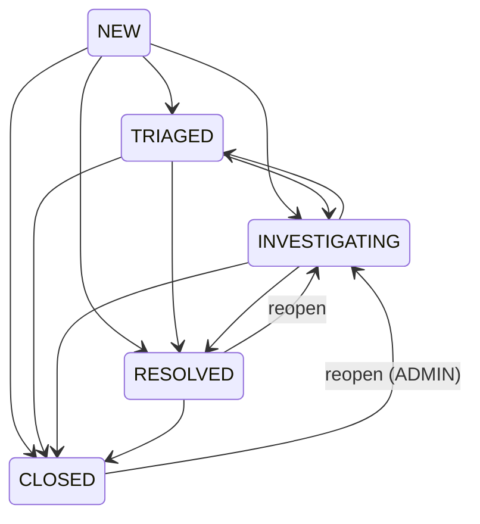

<!-- Copyright © 2026 Parsa Fathi — Apache-2.0 -->

# پاسخ به حادثه — چرخهٔ عمر و گردش کار (نسخهٔ فارسی)

در این سند «حادثه» یعنی incident (شناسه‌های `INC-xxxxxx`؛ در رابط کاربری فارسی:
«رخداد امنیتی»). چرخهٔ عمر حادثه فقط با **انتقال‌های اعتبارسنجی‌شدهٔ سمت سرور** جلو
می‌رود؛ UI هرگز تنها دروازه نیست.

نسخهٔ انگلیسی: [ARCHITECTURE.md](../../ARCHITECTURE.md) §5 — مطالعهٔ مرتبط:
[DETECTION_RULES_FA.md](DETECTION_RULES_FA.md) و [LOCAL_AI_FA.md](LOCAL_AI_FA.md).

## چرخهٔ عمر

## جدول انتقال‌های مجاز

| از | به | چه کسی | نکته |
|---|---|---|---|
| NEW | TRIAGED | ANALYST+ | طبقه‌بندی اولیه |
| NEW | INVESTIGATING | ANALYST+ | شتاب‌یافته به بررسی |
| NEW / TRIAGED | RESOLVED | ANALYST+ | خلاصهٔ راه‌حل الزامی (≥ ۱۰ نویسه) |
| NEW / TRIAGED / INVESTIGATING | CLOSED | ANALYST+ | بستن مستقیم |
| INVESTIGATING | TRIAGED | ANALYST+ | بازگشت به عقب‌روی |
| RESOLVED | CLOSED | ANALYST+ | مسیر معمول رسیدن به بسته |
| RESOLVED | INVESTIGATING | ANALYST+ | بازگشایی (reopen) |
| CLOSED | INVESTIGATING | **فقط ADMIN** | بازگشایی حادثهٔ بسته |

هر انتقال نامعتبر دیگر (مثلاً CLOSED→NEW) با خطای `INVALID_TRANSITION` رد می‌شود —
در سرویس Go با کد 409 و در پس‌زمینهٔ دموی کنسول با 400؛ در هر دو سرور اعمال می‌شود.

## همبستگی (چطور حادثه ساخته می‌شود)

وقتی یک قانون شعله می‌زند و تشخیص ساخته می‌شود:

1. سرور به‌دنبال یک حادثهٔ **باز** (غیر RESOLVED/CLOSED) با همان `ruleId` و همان
   `correlationKey` می‌گردد که `updatedAt` آن داخل پنجرهٔ همبستگی باشد (پیش‌فرض ۶۰۰
   ثانیه، قابل تنظیم).
2. پیدا شد → تشخیص و رخدادها به همان حادثه می‌چسبند، شدت به بیشینه ارتقا می‌یابد و
   مهرها به‌روز می‌شوند؛ تشخیصِ معادلِ تکراری به‌جای حادثهٔ جدید، به حادثهٔ باز می‌چسبد.
3. پیدا نشد → حادثهٔ جدید `INC-00000N` ساخته می‌شود (شماره‌گذاری ترتیبی و صفرپر).
4. رخداد دیررس (بیرون پنجره) باز هم می‌چسبد اما با پرچم `late: true` در جزئیات —
   پنهان نمی‌شود.

## یادداشت‌ها

- افزودن یادداشت با `POST /api/incidents/{id}/notes` (ANALYST+)؛ متن حداکثر ۴۰۰۰ نویسه.
- یادداشت خالی با 400 رد می‌شود.
- بستهٔ شواهد دستیار از خود حادثه، رخدادهای متصل، تعاریف قوانین و بافت ML ساخته
  می‌شود (طبق تعریف قرارداد)؛ یادداشت‌ها جزء بسته نیستند.

## گزارش AI — همیشه مشورتی

گزارش تحقیق هوش مصنوعی (بند [LOCAL_AI_FA.md](LOCAL_AI_FA.md)) این کارها را **نمی‌تواند**
بکند: تغییر وضعیت حادثه، حل‌کردن، بستن، ویرایش قانون یا هر تغییر دیگری در سامانه. گزارش
فقط خواندنی ذخیره می‌شود و در UI به‌عنوان مرجع مشورتی نمایش داده می‌شود. تصمیم و اجرا
همیشه با تحلیلگر انسانی است و در ممیزی ثبت می‌شود.

## ممیزی

هر انتقال وضعیت، واگذاری و راه‌حل با «چه کسی + چه زمانی + از/به» ثبت می‌شود
(`statusHistory` روی خود حادثه + رد ممیزی کلی). خلاصهٔ راه‌حل روی حادثه ذخیره می‌شود و
شرط حداقل ۱۰ نویسه سمت سرور اعمال می‌شود (`RESOLUTION_REQUIRED`).

## بازگشایی

- `RESOLVED → INVESTIGATING` با ANALYST+ مجاز است (بازگشایی حل‌شده).
- `CLOSED → INVESTIGATING` فقط ADMIN — بسته‌شدن حالت پایانی است و بازگشایی آن یک تصمیم
  مدیریتی ممیزی‌شده محسوب می‌شود.

## گردش کار پیشنهادی (نقش ANALYST)

1. در «صف رخدادها» حادثه‌های NEW را طبقه‌بندی یا واگذاری کنید.
2. در «بررسی و تحقیق» خط زمانی رخدادها را ببینید، تشخیص‌های متصل را باز کنید و در صورت
   تمایل «تحلیل هوش مصنوعی» تولید کنید (مشورتی).
3. با کافی‌بودن شواهد، «حل» را با خلاصهٔ راه‌حل اجرا کنید؛ بعد از تایید نهایی «بستن».
4. برای گزارش رسمی، از برون‌بری JSON شواهد در همان بخش استفاده کنید.
